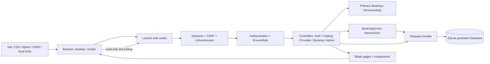
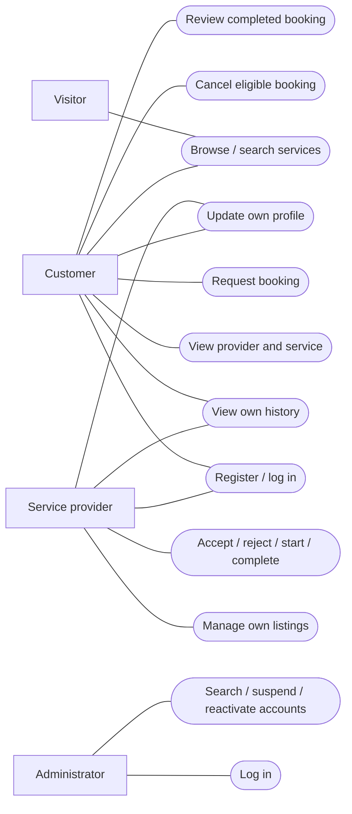
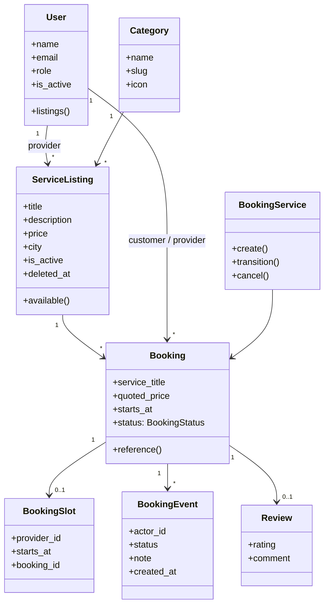
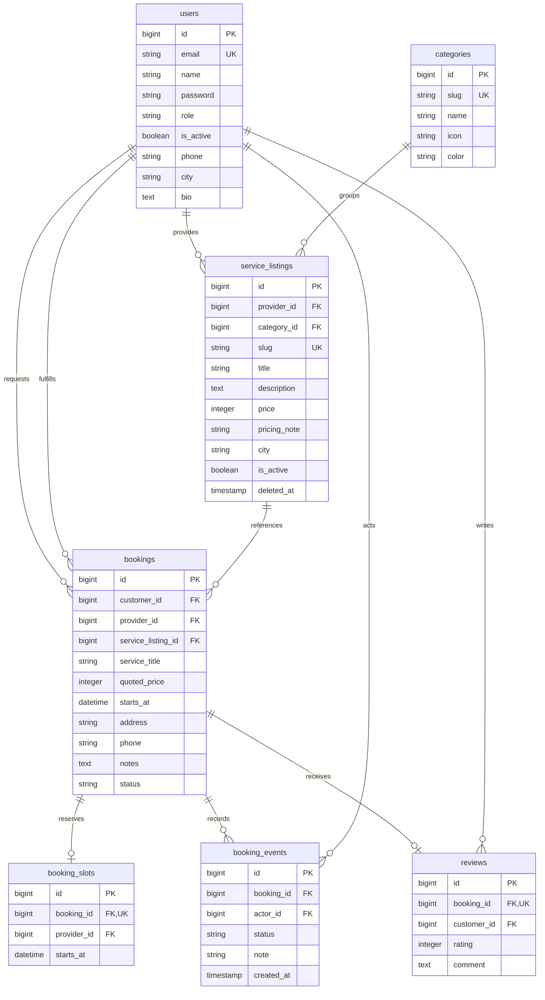
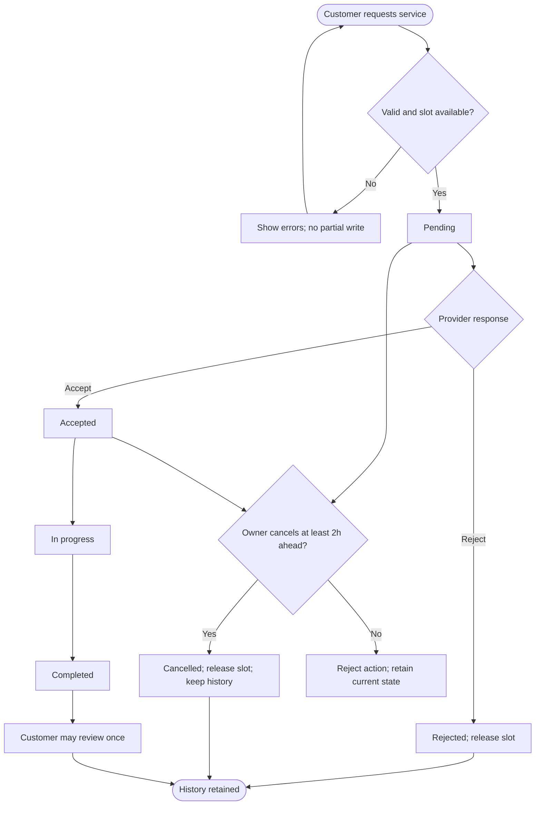

# System design
Diagrams are editable Mermaid sources. GitHub and many Markdown viewers render them. The application screens themselves are the implemented UI prototype.

## D-01 Architecture


One deployable Laravel application is appropriate for this mini project. Server-rendered pages work without a second frontend API architecture. The isolated slot endpoint returns only unavailable times, not private booking details.

## D-02 Use case diagram


## D-03 Domain/class model


BookingSlot is a database reservation record accessed intentionally through the query builder; the remaining persisted domain entities are Eloquent models.

## D-04 Database / ER diagram


Composite UNIQUE(provider_id, starts_at) on booking_slots is the conflict guard. Each booking has at most one reservation and one review. User references are retained; suspension replaces destructive deletion. Prices are whole LKR integers to avoid floating-point rounding. Framework tables also store sessions, password-reset tokens, cache and queue jobs. No queue delivery is required by the current workflows.

## D-05 Sequence: request a booking
```mermaid
sequenceDiagram
  actor Customer
  participant UI as Booking page
  participant Controller as BookingController
  participant Service as BookingService
  participant DB as Database
  Customer->>UI: Select date/time and enter details
  UI->>Controller: POST /services/{slug}/book + CSRF
  Controller->>Controller: Authenticate, authorize role, validate
  Controller->>Service: create(customer, listing, data)
  Service->>DB: Begin transaction; reload listing
  Service->>DB: Insert pending booking + quote snapshot
  Service->>DB: Insert unique provider/time slot
  alt Slot is already reserved
    DB-->>Service: Unique constraint failure
    Service->>DB: Rollback all writes
    Service-->>UI: Validation error; choose another time
  else Available
    Service->>DB: Insert first timeline event; commit
    Service-->>Controller: Booking
    Controller-->>UI: Redirect to booking detail
    UI-->>Customer: Pending status and reference
  end
```

## D-06 Sequence: provider responds
```mermaid
sequenceDiagram
  actor Provider
  participant UI as Booking detail
  participant Controller as BookingController
  participant Policy as BookingPolicy
  participant Service as BookingService
  participant DB as Database
  Provider->>UI: Accept, reject, start or complete
  UI->>UI: Accessible confirmation dialog
  UI->>Controller: PATCH status + CSRF
  Controller->>Service: transition(booking, provider, status)
  Service->>DB: Begin transaction; lock/reload booking
  Service->>Policy: Authorize assigned provider
  Service->>Service: Validate allowed transition
  Service->>DB: Update booking and append event
  opt Rejected
    Service->>DB: Remove reserved slot
  end
  Service->>DB: Commit
  Controller-->>UI: Success and updated timeline
```

## D-07 Activity: booking lifecycle and CR-01


## D-08 Interface wireframes
### Discovery
```text
[Sidebar: Explore / Overview / Bookings / Profile] [Location / Account]
[Page title]
[Home-care banner with compact introduction]
[Search text                       | City | Find services]
[All] [Cleaning] [Plumbing] [Electrical] [Painting] [Gardening] [AC]
[Result heading                                     | Sort]
[Service card]              [Service card]          [Service card]
[Pagination]
```
### Service and booking
```text
[Back]
[Photo / category]                         [Starting quote]
[Title / city / review summary]            [Date]
[Service description / pricing note]       [Available two-hour slots]
[Provider introduction]                    [Address / contact / notes]
[Completed-booking reviews]                [Request booking]
```
### Workspace
```text
[Greeting                                  | Add/find service]
[Total] [Active] [Completed] [Quoted value]
[Recent bookings: title, person, date, status]
[Booking detail: plan + event timeline | participant + actions]
```
### Mobile
At 760 px and below, navigation becomes a drawer. Forms stack, category cards scroll horizontally, booking details stack and tables scroll inside their container. Under 440 px, service cards use one column. Motion never supplies essential information.

## Decisions and tradeoffs
- Fixed slots give predictable overlap prevention; custom schedules are future scope.
- Active pending requests reserve time immediately, preventing duplicate requests for the same provider.
- Soft deletes and snapshots preserve history; no hard user deletion UI.
- Independent policies protect object-level access even when a route role is correct.
- CSRF and session authentication remain within Laravel’s standard web stack.
- SQLite is suitable for demonstration, not a claim of enterprise write capacity.
- Reviews are verified against completed booking ownership, not against a real-world provider identity.
